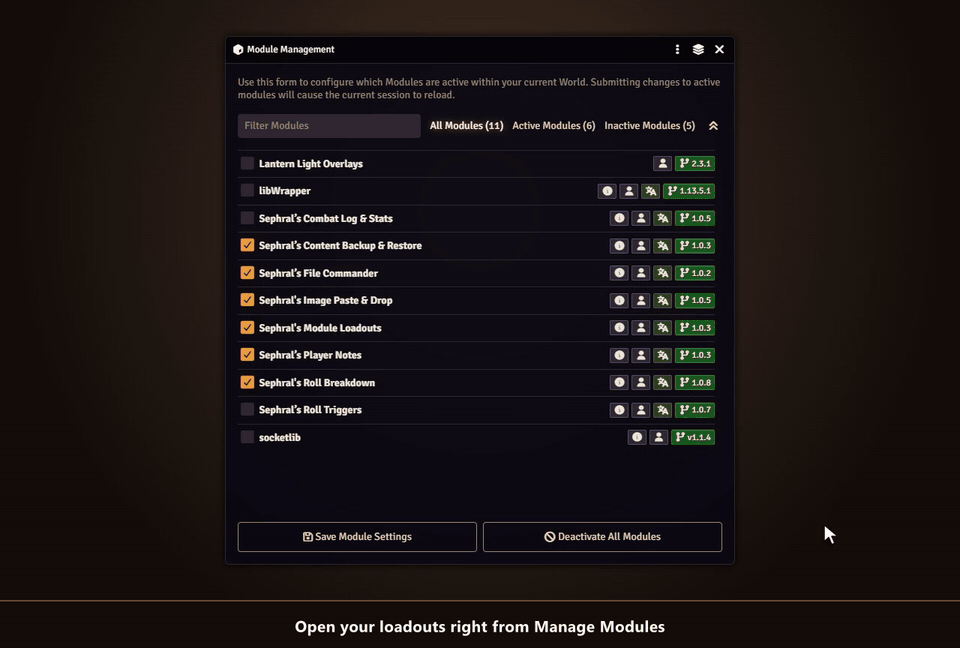

# Sephral's Module Loadouts

**All modules for game night, a lean set for prep, almost nothing while you hunt a bug.** Module Loadouts saves each setup as a loadout and switches between them with one click.

## Highlights

* **Save your setup:** store the active modules as a named loadout with a description and tags.
* **Switch with one click:** apply a loadout and exactly its modules are active.
* **See before you switch:** every loadout shows which modules it would enable, disable or cannot find.
* **Undo included:** before every switch your current setup is saved automatically. One click takes you back.
* **Checked after the restart:** the next start tells you if a module of the loadout did not come up or threw errors, and offers to undo the switch right there.
* **No broken worlds:** required dependencies are switched on for you, and missing ones stop the switch before anything breaks.
* **One world or all of them:** keep a loadout in a single world or use it in every world of your installation.
* **Stay organized:** tags, search, duplicates for variants and a JSON export to back up or share your loadouts.
* **Right where you need it:** open the manager from Foundry's Manage Modules window or from the settings. A hotbar macro switches loadouts too.

## How it works

1. Open **Manage Modules** and click the layers icon in its title bar.
2. Save your current setup as a loadout, for example *Game Night*.
3. Later, pick a loadout such as *Prep*, *Minimal* or *Debug* and apply it.

## Install

Search for **Module Loadouts** in Foundry's module browser or open the [package page](https://foundryvtt.com/packages/sephrals-module-loadouts).

Foundry VTT v13 and v14 · any game system · English and German

## Learn more

The [manual](MANUAL.md) explains world and installation loadouts, the undo snapshots, export and import and the macro API.

Questions or ideas? Join us on [Discord](https://discord.gg/7BjCgDYaBP). Looking for more? See [all modules by Sephral](https://github.com/Sephral).

## License

See [LICENSE.md](LICENSE.md).
